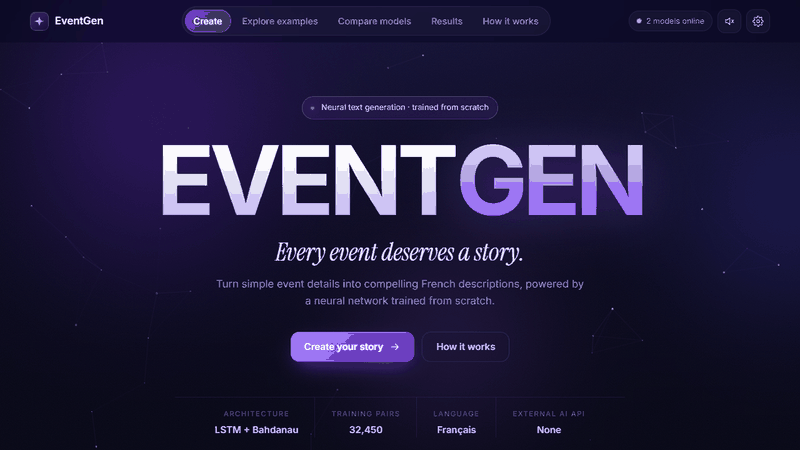
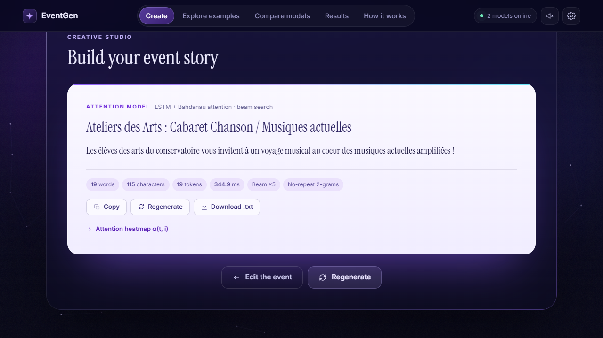
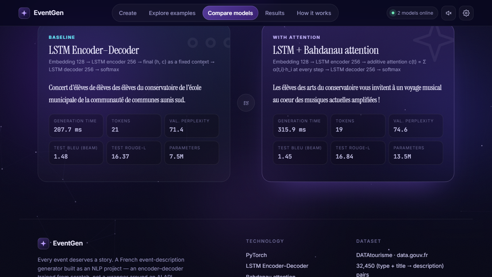
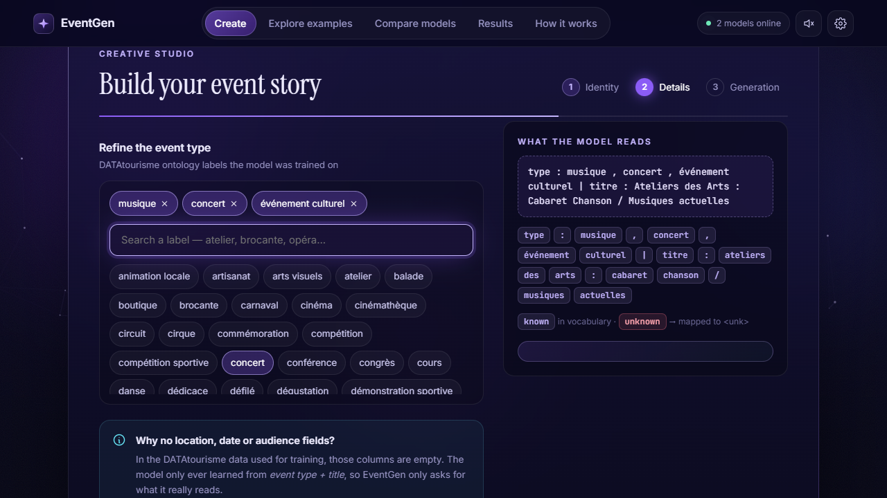
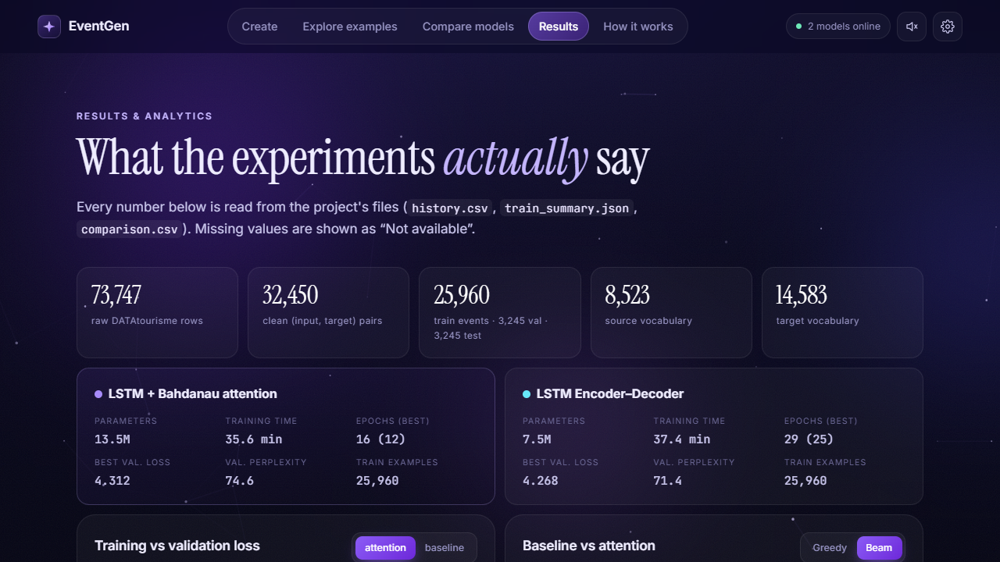
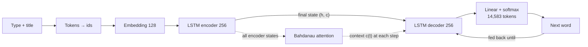
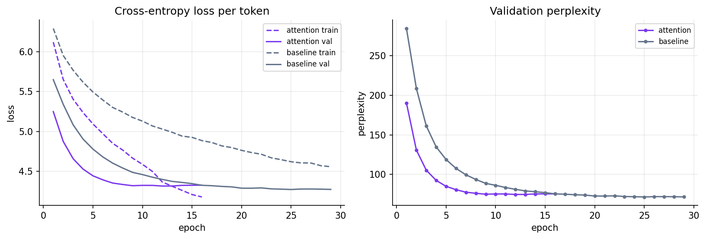

# EventGen

**Generating French event descriptions with an LSTM encoder–decoder and attention.**

EventGen reads the type and the title of an event and writes its description in French, word by word.
The two models were implemented and trained from scratch in PyTorch for an NLP course project,
with no pretrained language model and no external API.



▶️ **[Watch the full demo video (1 min 11)](assets/demo.mp4)**

```
input  : type : musique , concert , événement culturel | titre : Ateliers des Arts : Cabaret Chanson / Musiques actuelles
output : Les élèves des arts du conservatoire vous invitent à un voyage musical au coeur des musiques actuelles amplifiées !
```

---

## Contents

1. [The application](#the-application)
2. [Architecture](#architecture)
3. [Data](#data)
4. [Training](#training)
5. [Results](#results)
6. [Examples](#examples)
7. [Limits](#limits)
8. [Run it](#run-it)
9. [Project layout](#project-layout)

---

## The application

A web studio (Starlette backend and HTML, CSS and JavaScript frontend) runs the trained models.
It has five tabs.

| Tab | What it does |
|---|---|
| **Create** | Type a title, pick the event types, choose the model and the decoding, then generate. |
| **Explore examples** | Ready-made events, plus a real test event the model never saw, with its true description. |
| **Compare models** | The baseline and the attention model read the same input; their texts appear side by side. |
| **Results** | The real numbers of the project: data, training curves and test metrics. |
| **How it works** | The steps from the title to the text, and the honest limits of the model. |

| Generation | Compare models |
|---|---|
|  |  |
| **What the model reads** | **Results** |
|  |  |

---

## Architecture



| | Baseline | Attention |
|---|---|---|
| Embeddings | 128 dimensions, learned from scratch | same |
| Encoder | 1-layer unidirectional LSTM, 256 units | same |
| Link to the decoder | final state (h, c) only, a fixed context | (h, c) starts the decoder, plus a new context c(t) at every step |
| Decoder | LSTM 256 → linear layer → softmax | input [embedding of the previous word; c(t)] → LSTM → linear layer |
| Attention | none | additive (Bahdanau): e(t,i) = vᵀ tanh(W_h h_i + W_s s_{t-1}), α = softmax(e), c(t) = Σ α h_i |
| Parameters | 7,495,927 | 13,489,527 |

**How it generates.** The encoder reads the input and summarises it. The decoder starts from the `<sos>`
token, predicts the most likely next word, feeds it back as its next input, and stops at `<eos>`
or after 60 tokens. Decoding is greedy or beam search. The web studio also blocks numbers absent
from the input, doubled tokens and endings on a weak word such as « de ».

---

## Data

**Source: DATAtourisme**, the French national tourism database, published as open data on
[data.gouv.fr](https://www.data.gouv.fr). It holds 73,747 events in French. Of its 17 columns,
13 are 100% empty (place, dates, contacts), so the model uses the **type and the title** as input and
the **description** as output.

| Step | Rows |
|---|---|
| Raw events | 73,747 |
| Clean events | 35,245 |
| Valid (input, output) pairs | 32,450 |
| **Train / validation / test** (80 / 10 / 10) | **25,960 / 3,245 / 3,245** |

- **Cleaning:** HTML, URLs, e-mails and phone numbers removed; empty, duplicated or too short descriptions dropped.
- **Leak-free split:** events that share a title or the same description opening stay in the same split, so the test set shares no title and no description with training.
- **Vocabulary:** built on the training set only, with 8,523 input tokens and 14,583 output tokens, plus `<pad>`, `<unk>`, `<sos>` and `<eos>`.
- **Lengths:** inputs up to 40 tokens, outputs up to 60, cut at a sentence end.
- **Studied but not used:** a duplicate CSV export of DATAtourisme, a synthetic English dataset from Hugging Face, an English `Events.csv` file (about 900 unique texts) and an off-topic Mendeley dataset.

---

## Training

| Setting | Value |
|---|---|
| Loss | token-level cross-entropy, `<pad>` ignored |
| Optimiser | Adam, learning rate 0.001, halved when validation stalls |
| Batch size | 32 |
| Dropout | 0.3 |
| Teacher forcing | 0.5 |
| Gradient clipping | 1.0 |
| Early stopping | 4 epochs without progress, best checkpoint kept |
| Seed | 42 |
| Hardware | Google Colab, T4 GPU |

| Model | Epochs (best) | Time | Validation perplexity |
|---|---|---|---|
| First trial (2,000 examples) | 2 | a few minutes | 474 |
| Baseline | 29 (25) | 37 min | 71.4 |
| Attention | 16 (12) | 36 min | 74.6 |



The baseline underfits: its losses level off high. The attention model starts to overfit after
epoch 12: its training loss keeps falling while its validation loss stalls.

---

## Results

Scores on the 3,245 test events.

| Model | Decoding | Perplexity | Token accuracy | BLEU | ROUGE-L | Repetition |
|---|---|---|---|---|---|---|
| Baseline | Greedy | 75.1 | 24.0% | 1.30 | 14.18 | 58.3% |
| Baseline | Beam (3) | 75.1 | 24.0% | 1.48 | 16.37 | 36.4% |
| Attention | Greedy | 78.5 | 24.1% | 1.60 | 15.66 | 70.0% |
| Attention | Beam (3) | 78.5 | 24.1% | 1.45 | 16.84 | 42.7% |

- **Attention gives no clear gain:** slightly better ROUGE-L, but worse perplexity and more repetition.
- **Beam search repeats less,** but its texts are short: about 17 tokens, against 30 for the references.
- **The decoding rules** of the studio bring invented numbers, doubled tokens and cut endings to 0% on 300 test events, but they do not improve the meaning.

---

## Examples

| Title | Generated text | Result |
|---|---|---|
| Ateliers des Arts : Cabaret Chanson / Musiques actuelles | Les élèves des arts du conservatoire vous invitent à un voyage musical au coeur des musiques actuelles amplifiées ! | Success |
| Portes ouvertes Domaine Lang - Spécial Noël | Plongez dans l'univers des fêtes de noël, découvrez les portes ouvertes à l'occasion d'une balade gourmande et conviviale. | Success |
| Marché de Noël | Marché de noël organisé par le comité des fêtes. | Success |
| match de foot tunisie contre japon | Match d'un concert, c'est un nouveau spectacle ! | Failure |

The first trial, trained on 2,000 examples for 2 epochs, only wrote « Le de de de, de,,, de de. ».

---

## Limits

- **The input is thin:** the title gives neither the place nor the programme, so the model invents details or stays generic.
- **Rare topics fail:** « foot » appears in only 17 training titles.
- **Short and repetitive texts:** training descriptions have a median of 25 words.
- **More parameters did not help:** the attention model has almost twice as many, without a clear gain.
- **No copy mechanism:** proper nouns outside the vocabulary cannot be reproduced.
- **One reference per event,** so BLEU and ROUGE under-rate valid paraphrases.

Next steps: a bidirectional encoder, several teacher-forcing ratios, and a larger dataset with places and dates.

---

## Run it

Trained checkpoints and datasets are not in this repository because of their size.

```bash
python -m venv .venv
.venv/Scripts/python.exe -m pip install -r requirements.txt
.venv/Scripts/python.exe -m pytest -q
```

Train and evaluate (put the DATAtourisme files in `data/raw/` first, or use
`notebooks/00_colab_run_all.ipynb` on a GPU):

```bash
.venv/Scripts/python.exe scripts/01_eda.py
.venv/Scripts/python.exe scripts/02_prepare_data.py
.venv/Scripts/python.exe scripts/03_train.py --model baseline
.venv/Scripts/python.exe scripts/03_train.py --model attention
.venv/Scripts/python.exe scripts/04_evaluate.py
.venv/Scripts/python.exe scripts/05_error_analysis.py
```

Start the web studio, then open http://127.0.0.1:8000 (on Windows, `Lancer EventGen.bat` does the same):

```bash
.venv/Scripts/python.exe server.py
```

Options for `03_train.py`: `--epochs --batch_size --lr --tf --emb_dim --hid_dim --n_layers --dropout
--patience --max_minutes --subset --tag --resume`.

---

## Project layout

```
EventGen/
├── server.py                 web studio API (Starlette)
├── web/                      frontend: index.html, styles.css, app.js
├── app.py                    simpler Streamlit interface
├── src/
│   ├── preprocessing.py      normalise, tokenise, detokenise
│   ├── vocabulary.py         word2idx / idx2word, special tokens
│   ├── dataset.py            Dataset and padding
│   ├── encoder.py  decoder.py  attention.py  seq2seq.py
│   ├── training.py           training loop, early stopping, checkpoints
│   ├── inference.py          greedy and beam search, decoding rules
│   └── evaluation.py         BLEU, ROUGE, repetition, coverage
├── scripts/                  01_eda → 05_error_analysis
├── notebooks/                Colab pipeline and step-by-step notebooks
├── results/                  figures, metrics and generated examples
├── assets/                   README screenshots and demo video
└── tests/test_pipeline.py    unit tests
```
